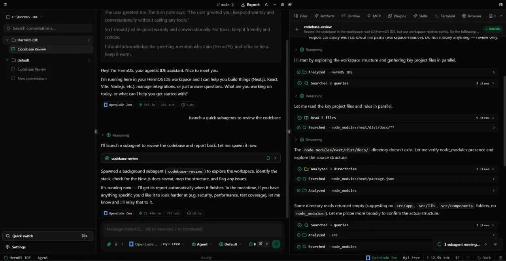

# HermOS IDE — Local-First AI Agent Desktop IDE

[](https://github.com/WFekik/HermOS-IDE/releases/latest)
[](https://apps.microsoft.com/detail/9NJXKNSS00WQ)
[](https://m8ven.ai/mcp/wfekik/hermos-ide)
[](LICENSE)
[](https://hermos.is-a.dev)

**Your code stays on your machine. Your models, your keys, your data — never leave your device.**

HermOS IDE is a next-generation desktop code editor with a built-in autonomous coding agent. It runs entirely on your computer: edit files, run commands, browse the web, and generate documents — all powered by your own local or cloud AI provider keys. No mandatory accounts, no cloud middleman, and zero telemetry.



---

## Why HermOS?

- **100% Local & Private** — All state, transcripts, and embeddings live in a local SQLite database on your machine. No remote servers, no analytics, no tracking.
- **Bring Your Own Keys** — Direct HTTPS connection to OpenAI, Anthropic Claude, Groq, Mistral, Together, OpenRouter, NVIDIA NIM, and local offline models via [Ollama](https://ollama.com).
- **Autonomous Coding Subagents** — Parallel DAG worker trees investigate codebases, write unit tests, and resolve diagnostics concurrently without blocking your editor.
- **Works Fully Offline** — Air-gapped local inference with Ollama. Terminal, file tools, and editor run seamlessly without an internet connection.
- **Model Context Protocol (MCP) Native** — Full client and server compliance with standard OpenAI and Anthropic tool execution hints (`readOnlyHint`, `destructiveHint`, `idempotentHint`, `openWorldHint`).
- **Office Studio Built-in** — Generate and inspect PowerPoint presentations (.pptx), Word documents (.docx), and PDF reports directly from natural language prompts.

---

## Download

Get the official release for your operating system:

| Platform | Channel | Link | Notes |
|:---|:---|:---|:---|
| **Windows** | **Microsoft Store** | [**Get from Microsoft Store**](https://apps.microsoft.com/detail/9NJXKNSS00WQ) | Officially signed by Microsoft · Automatic silent updates · Zero SmartScreen warnings |
| **macOS** | **GitHub Release** | [**HermOS.IDE Universal .dmg**](https://github.com/WFekik/HermOS-IDE/releases/latest) | Apple Silicon (M1/M2/M3/M4) & Intel Universal binary |
| **Linux** | **GitHub Release** | [**HermOS.IDE .deb package**](https://github.com/WFekik/HermOS-IDE/releases/latest) | Debian / Ubuntu 22.04+ compatible x64 package |

Browse all release assets and checksums on the [Releases page](https://github.com/WFekik/HermOS-IDE/releases/latest).

> **Official Website & Docs:** [https://hermos.is-a.dev](https://hermos.is-a.dev)

---

## Getting Started in 3 Steps

### 1. Install
Install HermOS IDE via the Microsoft Store on Windows, or open the installer on macOS/Linux. On first launch, HermOS initializes its local database and generates unique device encryption keys — no sign-up or telemetry prompts.

### 2. Configure Your AI Provider
Open **Settings → Providers** and paste your API key or configure your local server:
- **Local (Offline & Free)**: [Ollama](https://ollama.com) — run `ollama serve` and connect to `http://localhost:11434/v1`
- **Cloud Models**: Anthropic Claude (Sonnet / Opus / Extended Thinking), OpenAI (GPT-4o, o-series), Groq (LPU 500+ T/s), Mistral, NVIDIA NIM, OpenRouter.

All keys are encrypted at rest on your disk using AES-256-GCM.

### 3. Start Building
- **Open Workspace**: Select any local folder or Git repository.
- **Agent Modes**:
  - `Chat`: Interactive Q&A and code explanation.
  - `Architect`: Systematic design and multi-file implementation planning.
  - `Agent`: Full autonomous tool execution (read, edit, test, run terminal commands).
- **Run & Preview**: Integrated terminal and headless browser previews live directly inside the IDE.

---

## Privacy, Security & MCP Standards

- **Local-First Storage**: User databases, conversation checkpoints, and secrets reside strictly in standard OS application data paths (`%APPDATA%\com.hermos.ide` on Windows, `~/.config` on Linux, `~/Library/Application Support` on macOS).
- **AES-256-GCM Cryptographic Vault**: API keys and secrets are encrypted with authenticated AES-256-GCM and verified with 16-byte authentication tags.
- **Loopback Enforcement & SSRF Defense**: Internal processes strictly bind to `127.0.0.1` and enforce port allowlisting to shield local databases, Docker daemons, and SSH ports.
- **MCP Quality Standard**: Fully certified against the M8ven MCP Trust Index with explicit tool declarations and execution isolation.

---

## System Requirements

- **Windows**: Windows 10 / 11 (64-bit)
- **macOS**: macOS 12 (Monterey) or later (Apple Silicon & Intel)
- **Linux**: Ubuntu 22.04+, Debian 12+, or modern systemd-based distribution
- **Hardware**: 4 GB RAM minimum (8 GB+ recommended), 500 MB disk space for IDE + project workspace storage
- **Local Models (Optional)**: Modern GPU with 8 GB+ VRAM recommended for running 7B-32B parameter models via Ollama.

---

## Contributing & Development

We welcome open-source contributions!
```bash
# Clone the repository
git clone https://github.com/WFekik/HermOS-IDE.git
cd HermOS-IDE

# Install dependencies
npm ci

# Run in development mode
npm run tauri dev

# Run test suite
npm test
```

See [CONTRIBUTING.md](CONTRIBUTING.md) for full architecture notes, coding standards, and testing guidelines.

---

## License

HermOS IDE is open-source software licensed under the [MIT License](LICENSE).

[](https://m8ven.ai/mcp/wfekik/hermos-ide)
